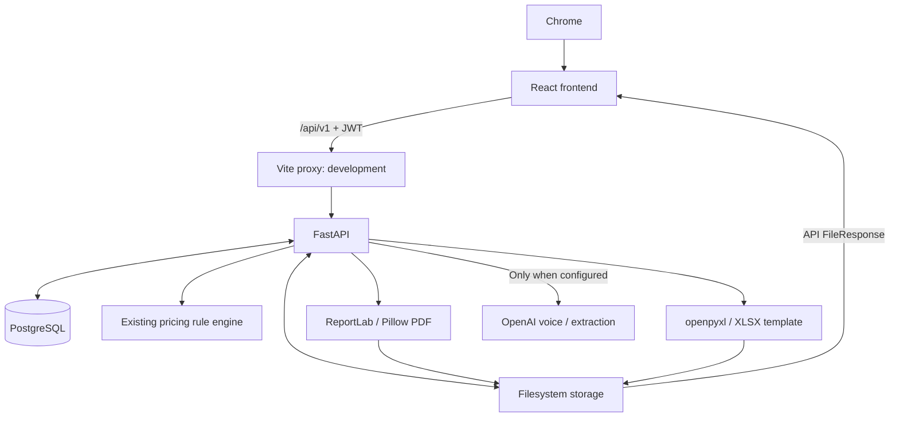

# Архитектура объединённого проекта

Текущая корпоративная подготовка: одна роль User для всех сотрудников, общие
сметы и Price Book, отдельные персональные пароли, история изменений и сохранённые
неизменяемые PDF/XLSX. Порядок SSH, миграций и будущего Railway-развёртывания:
[corporate-release.md](corporate-release.md).

## Границы модулей

Frontend — React 18 + TypeScript + Vite, React Router, TanStack Query, Lucide и обычный CSS. Исходники сгруппированы по страницам, UI-компонентам и сетевому/доменному коду. Фреймворк дизайна с навязанной сеткой карточек не используется.

Backend — сохранённый FastAPI/SQLAlchemy async. Его router prefixes и JSON-контракты остались прежними. DATABASE_URL выбирает PostgreSQL; STORAGE_PATH выбирает локальный или смонтированный файловый диск. Подключений к Supabase, Railway SDK и корпоративному GitHub нет.

В build-режиме FastAPI обслуживает React dist; Vite proxy отсутствует. API и storage доступны на том же origin. Это альтернативный способ обслуживания frontend, а не объединение доменной логики в один модуль.

## Frontend

- `src/lib/api.ts`: auth headers, JSON/FormData requests, ошибки, download Blob, URL фото, форматирование.
- `src/lib/auth.tsx`: JWT localStorage и текущий пользователь. Query cache очищается при logout.
- `src/lib/types.ts`: контракт существующего API. Money приходит из PostgreSQL как decimal string и преобразуется для UI.
- `src/lib/quickEstimate.ts`: восстановленные исходные room templates и ставки Quick; 27 parity-fixtures с прежней сборкой.
- `pages/Estimates.tsx`: список, фильтры/поиск в URL, создание/копирование, soft delete/restore.
- `pages/Builder.tsx`: orchestration сохранения сметы/зон/строк и экспортов. Выбранная зона хранится в URL.
- `components/LineItems.tsx`: редактирование по blur, reorder кнопками, ручной total, section, TBD, original price.
- `components/AddItems.tsx`: wall/cabinet/mirror калькулятор через API, manual items, services. Материал применяет прежний pricing addon.
- `components/Photos.tsx`: 4 слота зоны, MIME/size checks, замена/удаление, просмотр.
- `components/AiInput.tsx`: MediaRecorder/audio upload, транскрипция, подтверждение замены строк AI-результатом.
- `pages/QuickEstimate.tsx`: draft комнат в памяти, последовательное создание estimate/zones/items. При частичном сбое сохраняется ссылка на созданный draft.
- `pages/PriceBook.tsx`: редактирование текущей вложенной pricing config с сохранением полного JSON-контракта.
- `pages/Auth.tsx`, `pages/Onboarding.tsx`: auth и вводное ознакомление.

Общие компоненты Button/Field/Modal/Confirm/EmptyState/ErrorNotice задают одинаковые размеры, focus и обработку состояний. Native dialog обеспечивает focus trap и Escape. Длинные имена позиций редактируются textarea. Широкий Builder имеет отдельные scroll regions; ниже 1100px фото/estimate/zones переключаются вкладками, ниже 768px числовые поля становятся вертикальными группами.

## Backend и данные

Сохранены таблицы users, estimates, estimate_zones, line_items, estimate_images,
voice_files, pdf_files, pricing_config. Добавлены audit_events и document_versions,
а в users — is_active и token_version. Client-таблицы нет: client_name — поле
Estimate. Pricing defaults и формулы не изменены.

API endpoints остались в app/api/v1. Существующие генераторы в app/services. Models/schemas разделены, старый schemas/schemas.py сохранён как reference, хотя активные routes используют schemas/estimate.py и auth.py.

Схема изменяется только явными Alembic migrations 0001–0003. При запуске backend
проверяет revision, но не выполняет CREATE/ALTER. Для существующей локальной базы
есть проверяемая процедура adopt-legacy; production adoption требует отдельного
одобрения и анализа схемы.

## Storage и перенос локального состояния

На этом Mac используется текущая служба PostgreSQL 127.0.0.1:55432. Создана отдельная логическая БД wallpanels_platform через pg_dump/pg_restore исходной локальной wallpanels_local. Исходная БД не изменялась. Файлы скопированы в новый .local/storage, абсолютные file_path обновлены только в новой БД.

В .env LOCAL_PG_BIN/LOCAL_PG_DATA указывают на уже установленный локальный PostgreSQL из родительского окружения. Это путь к внешней службе разработки, не импорт исходников. Код/сборка не зависят от старых frontend/backend папок. На другой машине можно использовать системный PostgreSQL, Docker Compose или dev-provider через environment.

Фото, аудио и документы на диске; БД хранит пути. Для Railway подготовлен volume
/data. Публичная раздача /storage убрана: фотографии выдаются по authenticated API
через Blob URL в браузере. Замена/удаление фотографий сохраняет предыдущие файлы
для восстановления. Физическая очистка требует отдельной retention policy.

## Pricing и экспорты

Backend rule_engine.py и pricing_config.py не менялись. Исправлен слой сохранения позиций: явный total_price от калькулятора не теряется; иначе SF/LF получают qty × rate. Это сохраняет исходную фиксированную прибавку зеркала. При PATCH quantity/unit_price пересчитываются по прежнему правилу, теперь корректно обрабатывается ноль. Изменение qty ранее рассчитанного зеркала всё ещё требует повторного расчёта через калькулятор, чтобы сохранить installation fee.

Builder показывает прежнюю формулу sum(zone subtotal) × markup × discount. PDF независимо использует суммы зон, markup/discount и Pre range 90%–115%. XLSX сохраняет исходные item totals и шаблонные формулы. Унифицировать эти семантики без решения бизнеса в этом переносе не пытались.

Pre-Estimate V2 и Final Estimate — отдельные ReportLab/Pillow renderers с общей
доставкой Preview/Download. Final начинается с общей титульной страницы, строит
страницы зон с выбранной фотографией, добавляет Investment Summary и завершает
ровно 13 корпоративными страницами из versioned `company-slides.pdf` через pypdf
без повторного rasterization. XLSX создаётся openpyxl из
`project_passport_template.xlsx`. Поле `pdf_layout` хранит только настройки
презентации; цены и строки сметы не зависят от визуальной верстки.

## Границы Proposal Engine

Генераторы расположены в `app/services` и используют сохранённый Estimate как
read-only вход. Pre и Final не должны менять расчёты, фото или строки сметы при
просмотре/скачивании. Корпоративные assets версионируются отдельно от клиентских
фотографий; пользовательские загрузки остаются только в `STORAGE_PATH`.

## Локальная эксплуатация

Корень содержит npm workspace, lockfile, Python constraints и scripts/dev.py. Dev проверяет локальный listener PostgreSQL либо запускает настроенный pg_ctl/Docker, затем backend и Vite. PID identity проверяется перед stop. Логи и состояние в .local, секреты не выводятся. Shared PostgreSQL не останавливается вместе с приложением.

Переменные cloud/provider не встроены в source. .env — локальная конфигурация; .env.example — переносимый контракт. Для future build serving есть FRONTEND_DIST и корневой Dockerfile. Никаких remote, CI connections, Railway project IDs и autodeploy jobs не создано.

## Pre-Estimate Proposal, 22 October 2026

`pre_estimate_service.py` is a separate measured 16:9 renderer. Authenticated GET
`/pdf/:id/pre-estimate` loads the Estimate/zone/item/image graph, renders in a worker
thread to a temporary file, returns inline/attachment, then removes the temporary
file. It does not update the Estimate, saved type or pricing. Native PDF preview
uses an authenticated Blob URL and releases it on close.

Fonts are bundled in app/assets/fonts. Gallery uses contain with aspect-aware
layouts; no-photo and continuation pages share the same geometry. Existing
pdf_service.py remains the legacy Final renderer. The passport still uses its
original XLSX template; small TBD/zero-basis/recalculation fixes are documented
in bhupesh-local-qa.md. Current Final Proposal and corporate-slide assembly are
documented in final-estimate-premium.md and final-company-slides.md.
